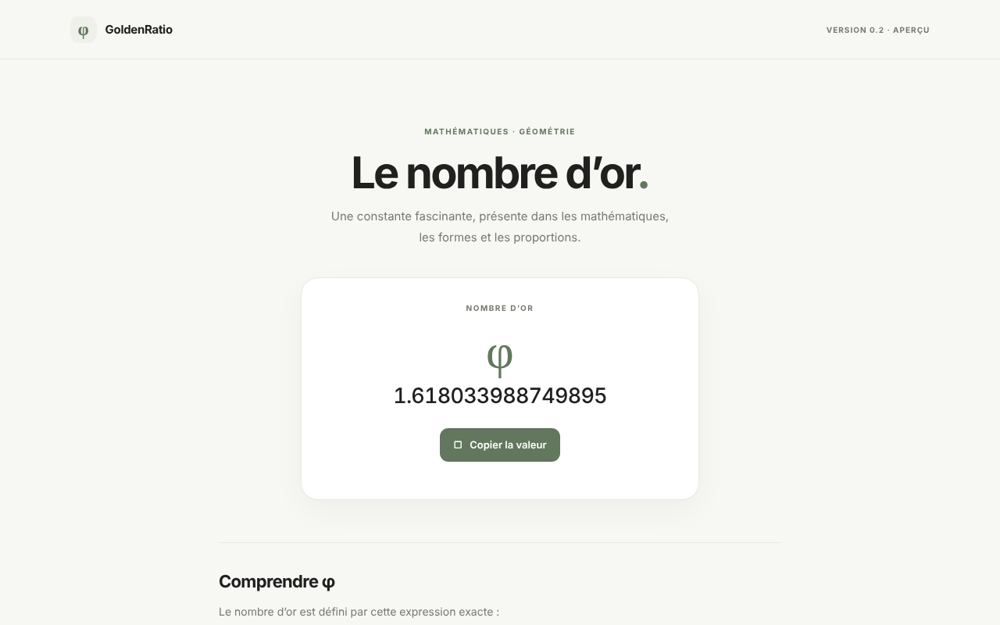

# GoldenRatio — le nombre d'or

**Une petite application web pour découvrir et calculer le nombre d'or, φ.**

👉 **[Ouvrir l'application](https://julesdemangeot-ship-it.github.io/GoldenRatio/)**



## Ce que fait l'application

- Affiche la valeur de φ ≈ 1.618033988749895, à copier en un clic
- Explique sa définition exacte : **φ = (1 + √5) / 2**
- Montre sa propriété remarquable : **φ² = φ + 1**
- S'installe comme une vraie application et fonctionne hors connexion

## L'installer

L'application s'installe directement depuis le navigateur, sans passer par un store.

| Appareil | Comment faire |
|---|---|
| Ordinateur (Chrome, Edge) | Icône d'installation dans la barre d'adresse → **Installer** |
| Android (Chrome) | Menu **⋮** → **Installer l'application** |
| iPhone (Safari) | Bouton **Partager** → **Sur l'écran d'accueil** |

## Le code

```
app/      l'application web (HTML, CSS, JavaScript, service worker)
src/      le calcul de φ en Python
tests/    les tests du calcul
```

### Utiliser le calcul en Python

```python
from src.math_utils import golden_ratio

print(golden_ratio())  # 1.618033988749895
```

### Lancer les tests

```bash
python3 tests/test_math_utils.py
```

### Lancer l'application en local

```bash
cd app
python3 -m http.server 8000
```

Puis ouvrir http://127.0.0.1:8000

## Mise en ligne

L'application est publiée automatiquement sur GitHub Pages à chaque modification de la branche `main` (voir `.github/workflows/static.yml`).
